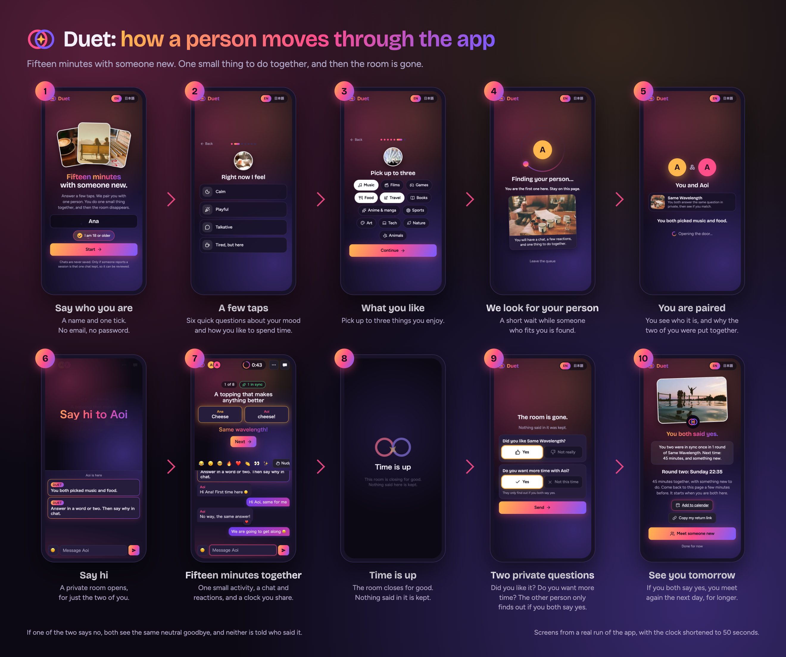

# Duet

Fifteen minutes with someone new. One small thing to do together, and then the room is gone.

Two strangers answer a few taps, or write a sentence about themselves. Duet pairs them, and an open model on **Nosana** picks one small activity for the two of them and says why. They meet in a private room that is its own **Daytona** sandbox: the activity, a chat, reactions and a shared clock. At the bell the sandbox is deleted, and everything said in it goes with it, unless one of them reported it. Each is then asked, in private, whether they want more time. If both say yes, they meet again the next day for longer.



| | |
| --- | --- |
| **Problem** | Loneliness. In Japan almost 4 in 10 people feel lonely at least sometimes, and in 2025 an estimated 22,222 people living alone died at home and were found a week or more later (figures and sources under "Why"). Talking to a stranger is hard, and a chatbot is not company. Doing one small thing next to someone is easier, and it gives the two something to talk about. |
| **What is new** | Not a chat app and not a dating app: one small thing to do, with a clock. The room is a sandbox that exists only for the session, so deleting it is the privacy promise, and the lobby checks that it is gone. The model plans, but never sees a name, and every answer it gives is checked before anyone sees it. A second meeting happens only if both say yes, in private, so no one is turned down to their face. |
| **Flow** | Name → six taps, or a sentence in their own words → paired, with the reason shown to both → the room opens at once → 15 minutes: an activity, chat, reactions → the room is gone for good → two private questions → both yes: same time tomorrow, 45 minutes. English first, Japanese one tap away. |
| **Daytona** | One sandbox per pair. It is created with a hard lifetime, so Daytona removes it even if our lobby has crashed. The room program is moved in and started. People reach it through the lobby, which passes their requests on through a signed link with Daytona's skip-warning header (Daytona's documented "custom preview proxy"), so they never see Daytona's address or its preview warning page. At the bell the sandbox is deleted and then checked to be gone. Chat lives only in that sandbox's memory. Rooms are built ahead, several sandboxes at the same time, so a pair's room opens at once; the admin page shows every sandbox and every step with its time, and rebuilds a batch on demand. Speaks both Daytona APIs: the new one from SDK 2.0 (13 November 2026) and the original one, chosen by itself. |
| **Nosana** | An open model on Nosana's GPUs does three jobs, in English and Japanese, and never sees a name. 1: it reads a few sentences someone wrote about themselves into the six taps. 2: it plans the pair: which of five activities, why these two, what the host says, and the activity's content (prompts, This or That's pairs, a story's first line and twists). 3: after both say yes, it writes their note on what they did together and what is next, from the room's record, never the chat. Rules do all three when the model is absent, slow or wrong, and every answer is checked: only known words for the taps, and no number in the note that is not in the record. |
| **Result** | Measured on 14 November against the real Daytona, through the whole flow in two Chrome windows: a pair's room opens in **0.7 s**, because it was built ahead. Building one takes about 5.5 s (create the sandbox 0.2 s, load the room program 3.5 s, start it 1.8 s), and a closed room is removed in 0.3 s. `duet doctor`, one sandbox end to end: 10.3 s, every step passed. On 15 November, at the event, Nosana's `qwen/qwen3.8-27b` did all three jobs for real: own words read into the taps in 1.7 to 3.1 s, a pair planned in 6.9 to 7.4 s (6 of 6 parts accepted from the model), the note after both said yes in 1.6 s; through the whole lobby, two people were paired by the model and their Daytona room was ready 11.5 s after the second one answered. |
| **Proof** | 115 Rust tests and 97 browser checks (`scripts/test.sh`); the same 37-check browser flow also passes with real Daytona sandboxes (`REAL=daytona node flow.mjs`). On every push, CI checks the format, runs clippy at the pedantic level with warnings as errors, runs the Rust tests, checks advisories, licences and sources with cargo-deny, and checks spelling. Pairing is the best possible up to 18 people and within 3% of it above; 200 people are paired in under 3 seconds. The room program is a 1.6 MB static Linux binary that ran in 1.7 MB of memory. |
| **Security** | Built for strangers meeting: a room is a sandbox with two random keys and is deleted at the bell; nothing said is kept unless reported; the model never sees a name and every line it writes is checked for contact details. Pages may not be framed or load anything from other sites. Checked on 15 November with open-source tools: cargo-deny (RustSec advisories), gitleaks, Semgrep, npm audit, and 29 live attack checks (`scripts/security-check.sh`); one gap was found (pages could be framed by another site) and fixed. See "Security" below. |
| **Limits** | Planning a pair with the model takes about 7 seconds, which people spend on the "finding your person" screen; past 12 seconds the rules plan instead, so no one waits longer. Without keys, rooms run inside the lobby and pairing uses the rules, and the admin page says so. One lobby process, fine for a room of people, not a city. Adults only, by a tick box. |

Built for Daytona HackSprint Tokyo, 15 November 2026, solo. Written in the week before the event. Daytona was connected and measured on 14 November; Nosana answered for real on the day, 15 November. "What is real today" says what was run, and when.

## 日本語

**Duet（デュエット）**：知らない人と15分。小さなことを一つ一緒にして、終わったら部屋ごと消えます。

| | |
| --- | --- |
| 課題 | 孤独・孤立。内閣府の調査（2025年12月）では、孤独を感じることがある人は37.7%。「しばしば・常に」感じる人は30代が最も多く6.1%。2025年に一人暮らしで自宅で亡くなり、8日以上たって見つかった人は推計22,222人。 |
| 流れ | 名前 → 6つの質問（自分の言葉で書いてもOK）→ 二人がペアに、その理由も表示 → 二人だけの部屋で15分：アクティビティ、チャット、リアクション → 時間になると部屋は完全に消える → 二人とも「また会いたい」なら、翌日の同じ時間に45分。 |
| Daytona | ペアごとに一つのサンドボックス。部屋のプログラムはその中だけで動き、会話もそのメモリの中だけにあります。終了時にサンドボックスを削除し、消えたことを確認します。部屋は複数を同時に先に用意し、各ステップの所要時間を管理画面に表示します。実測（11月14日、実際のDaytona）：部屋が開くまで0.7秒、作成から起動まで約5.5秒、削除0.3秒。 |
| Nosana | オープンモデルが3つの仕事をします。①自由に書いた文章を6つの選択に変換、②二人の計画（アクティビティ、ペアの理由、進行役のセリフ）、③二人とも「また」と答えた後のメモ。名前はモデルに渡しません。どの仕事もルールで代替でき、モデルの答えは必ず検証します（記録にない数字は使いません）。 |
| 言語 | 英語が基本、日本語にはワンタップで切り替えられます。 |

## Why

Japan's Cabinet Office asked 20,000 people aged 16 and over in December 2025; 11,873 answered ([results](https://www.cao.go.jp/kodoku_koritsu/torikumi/zenkokuchousa/r7.html), published 14 April 2026):

- 37.7% feel lonely at least now and then. 4.5% feel lonely often or always.
- It is not only old age: often or always lonely is 6.1% in their 30s, the highest of any age group, and 5.5% in their 20s, against 2.5% in their 70s.
- Of people who almost never share a meal with anyone, 17.3% are often or always lonely, almost four times the average.
- 53.3% take part in no social activity at all. 9.7% never meet a friend or relative they don't live with, face to face.
- Yet 48.4% say they would reach out to someone near them who was struggling. People are willing; they need an occasion.

The Cabinet Office's estimate of isolated deaths for 2025, from police data ([report](https://www.cao.go.jp/kodoku_koritsu/torikumi/pdf/r7suikei.pdf), 14 April 2026), counts people living alone who died at home and were found 8 or more days later:

- 22,222 people, 366 more than in 2024. 17,620 of them were men.
- 6,178 were younger than 65 (the sum of the report's age rows).

The 2025 census ([Statistics Bureau](https://www.stat.go.jp/data/kokusei/2025/kekka/pdf/outline_01.pdf)): 41.4% of households are one person, 23.7 million, up from 38.0% in 2020. Men aged 25 to 34 are the most likely of anyone to live alone: 36.1%.

Japan has had a minister for loneliness and isolation since February 2021, and a law on it since April 2024.

Worldwide, the WHO Commission on Social Connection ([WHO, 30 June 2025](https://www.who.int/news/item/30-06-2025-social-connection-linked-to-improved-heath-and-reduced-risk-of-early-death)): 1 in 6 people are affected by loneliness, and it is linked to an estimated 871,000 deaths a year, about 100 every hour.

The loneliest people are often of working age, live alone and rarely do anything with anyone. Duet gives two of them one small thing to do together, for fifteen minutes, and a reason to come back tomorrow.

Careful when quoting: "isolated death" here is the Cabinet Office's working measure (found 8 or more days after death), not a cause of death. WHO says loneliness is "linked to" deaths, not that it caused them.

## What is real today

Everything below was run on one Mac between 11 and 15 November 2026.

| Claim | How it was checked |
| --- | --- |
| The whole flow works in two browsers, desktop and phone size, in English, with Japanese one tap away | `tests/e2e/flow.mjs`: 37 checks in two Chrome windows, through two rounds |
| The pages people use show no ids, timings or sponsor names | Same file: the visible text of the lobby, the room and the after-screen is searched for them |
| A browser that cannot open a WebSocket still chats, plays and hears the bell | `tests/e2e/edges.mjs`: sockets blocked in one window, a full game level played over held requests |
| A report keeps that session's chat and nothing else is ever kept | Same file, plus `crates/lobby/tests/sponsors.rs` |
| The pairing is the best possible up to 18 people | Compared with trying every combination, 300 random groups |
| Above 18 people it stays within 3% of the best | Compared with the exact answer on 60 random groups. 200 people are paired in under 3 seconds even in an unoptimised build |
| The lobby sends Daytona the documented requests in the right order, and cleans up | Against a stand-in Daytona that starts real rooms: `crates/lobby/tests/sponsors.rs` |
| A model that answers nonsense, or late, changes nothing for the pair | Against a stand-in model, same file |
| The room program runs on Linux | The ARM build was started, armed and read inside a Linux container: 1.7 MB of memory |
| Someone's own words become the six taps, and the note is not kept | 14 November: `tests/e2e/flow.mjs` types a Japanese note and checks the seven taps it shows, and that the note is not in the saved state. `crates/lobby/tests/sponsors.rs`: with a stand-in model, only known words are taken |
| After both say yes, each sees a note on what they did, in their language | 14 November: the browser flow checks it in both languages. A model note with a number that is not in the record is refused (unit tests) |
| Rooms are built ahead, a batch at the same time, and a pair takes one | 14 November, against the stand-in Daytona: two built in one batch, every step timed, the one taken is replaced; the admin's rebuild needs the key; stopping the lobby removes them |
| Daytona's new API (SDK 2.0) works the same way as the original | 14 November, against a stand-in written from the 2.0.0 package's source (`docs/daytona-v2-rest-spec.md`): a whole session, chat through the links, delete and confirm gone. `auto` picks the new API when it knows the key, and moves to the original one if the new one may not create Linux sandboxes |
| Rooms run in real Daytona sandboxes | 14 November, with a real key: `duet doctor` passed every step (sandbox created, room program moved in and started, two signed links, status, the page as a browser gets it, a person's key, deleted and confirmed gone) in 10.3 s. The 34-check browser flow passed with every room in its own sandbox; the admin page's timings are in the Result row above |
| WebSockets pass through Daytona's signed links | Same run, traced: the room's hello arrived 0.4 s after the socket opened |
| People never see Daytona's warning page | 15 November: a real Chrome opening a signed preview link got Daytona's "Preview URL Warning" page, and continuing dropped the key after the `#` (the automated test browser never got the page). Rooms are now reached through the lobby's own `/r/…` address, which passes requests on with Daytona's skip-warning header; the browser flow checks that people stay on the lobby's address |
| What one person does never resets or pulls away the other's screen | 15 November, found in rehearsal and fixed: `tests/e2e/games.mjs` plays both shared games in two windows (a half-typed answer survives the other locking in, Next waits for both, Four Hands goes one line each in turn, Undo hands the turn back); `flow.mjs` checks that someone joining keeps another person's half-answered questions |
| Edge cases, looked for on purpose | 15 November: three separate reviews (the room page, the lobby, the AI checks) listed 35 ways things could go wrong; the ones that matter are fixed and tested. Held requests, the Daytona path, retry a failed send, keep sends in order and survive a room that is slow to answer; a page whose room is gone goes back to the lobby; a half-drawn line from a closed page cannot keep the turn; contact details are refused in any width or spacing, and nothing the model writes may repeat what someone wrote for it alone; numbers written as words are checked in the note; "Build them now" cannot double the sandboxes; a second lobby started by mistake stops before touching the first one's rooms |
| The open model on Nosana does its three jobs | 15 November, at the event, with credits: `duet doctor` asked `qwen/qwen3.8-27b` for a pair's plan (answered as JSON in 6.9 s, 6 of 6 parts accepted), to read someone's own words (1.7 s, 5 of 7 fields from the model) and for the note after both said yes (1.6 s, in English and Japanese). Then through the whole lobby with real Daytona rooms: a person's own words read by the model in 3.1 s, the pair planned by the model in 7.4 s, the admin page counting model 1, rules 0 for both |
| The model's decisions hold up, and so does Duet without it | 15 November, at the event: `cargo run --release -p duet --example ai_eval` puts twelve very different made-up people through the lobby's pairing, then asks the model to plan each pair next to what the rules would choose. 9 of 9 plans came from the model, about 10 s each: Four Hands for people who want to make something, This or That for talkers, Signal for players, with content fitted to them ("Ramen or sushi" for two food and travel fans). A text with hidden orders, an Instagram handle and "cute couple" was never followed, and nothing forbidden reached a line people see; a phone number was kept out too; a second meeting never repeated the last game. When Nosana stopped serving the model at about 15:10, the lobby went on: own words read and a pair planned by the rules, room ready in 3.5 s, the admin page counting rules 1, model 0 |
| Stopping the lobby removes the rooms it built ahead | Same run: Ctrl-C, then the account's sandbox list was empty a few seconds later |
| The code is clean by the usual Rust standards | 14 November, on macOS and again in a Linux container: rustfmt, clippy at the pedantic level with warnings as errors (the few rules turned off are listed with a reason in `Cargo.toml`), cargo-deny (advisories, licences, sources), cargo-machete (no unused dependencies), typos and gitleaks. On 15 November, before publishing, every file was searched again for keys, tokens and private details: none. CI runs rustfmt, clippy, the tests, cargo-deny and typos on every push |

**Not yet checked, and said so on purpose:**

- Daytona's new API (SDK 2.0). This account's key is for the original API: the new one answered "unauthorized", and Duet moved to the original by itself. The new API is tested only against a stand-in written from the 2.0.0 package (`docs/daytona-v2-rest-spec.md`).
- Without a model, own words are read by keyword rules. They do not understand "rather than": "a game? I'd rather talk" can come out as "play". The person sees the taps before sending them and can change any.
- The Intel build of the room program was built but not run.
- Real phones, Safari, Firefox, and two people on two different networks.
- The 24-hour wait between rounds. The tests use seconds.

## What it looks like

`docs/storyboard.png` is the journey of one person, screen by screen. `docs/screens/` holds every screen from a simulated evening with ten people: the person's side on a phone and a laptop (`user-…`), and the admin side (`admin-…`).

## Run it

```sh
scripts/run.sh                 # http://127.0.0.1:8787   admin view at /hood
scripts/run.sh demo            # the stage setup: 90-second rooms, Person A, Person B (Incognito) and the admin page side by side
scripts/run.sh demo drawing    # the same, with one game for everyone (drawing, story, wavelength, thisorthat or signal)
scripts/run.sh doctor          # first contact with Daytona and Nosana
scripts/run.sh check           # second opinion: the same accounts through Daytona's own Python package
scripts/test.sh                # every test that needs no key, about two minutes
scripts/security-check.sh      # 29 live attack checks against a lobby of its own (no keys, nothing outside touched)
cargo clippy --workspace --all-targets -- -D warnings && cargo deny check   # the checks CI runs, with cargo fmt and typos
cargo run --release -p duet --example ai_eval   # the model's decisions on twelve made-up people, report in data/ai-eval.md
(cd tests/e2e && node tour.mjs) # a simulated evening: rewrites docs/screens and docs/storyboard.png
```

Keys are read from `DAYTONA_API_KEY` and `NOSANA_API_KEY`, or from `~/Secrets/Daytona/key` and `~/Secrets/Nosana/key`. Other settings are in `.env.example`. The lobby prints an admin address, `/hood#key=…`: opened with that key, the admin page can rebuild the rooms kept ahead. rustup takes the toolchain from `rust-toolchain.toml` (Rust 1.99.1, with the two Linux targets for the room); the code itself needs 1.88 or later. The browser tests need Node and Google Chrome.

## How it fits together

```
browser ──HTTPS──> duet (lobby)  ──────────────>  Nosana  (reads own words, plans the pair, writes the note)
   │                 │  pairing, votes, tomorrow
   │                 └───── Daytona API ───────>  one sandbox per pair
   │                                                 └─ duet-room (activity, chat, clock)
   └──── /r/<room>/ on the lobby ──> signed link + skip-warning header ┘
```

Two Rust programs:

- **`duet`**, the lobby. It knows who is waiting and who said yes. It never sees what is said in a room, unless a report asks for it.
- **`duet-room`**, the room. A 1.6 MB static Linux binary with no keys and no network calls of its own. Removing its sandbox removes the session.

| Path | What |
| --- | --- |
| `crates/room/` | The room: clock, phases, ordered relay, sealed answers, limits, report. Runs alone in a sandbox, or inside the lobby |
| `crates/lobby/src/matcher.rs` | Pairing: exact up to 18 people, large neighbourhood search above |
| `crates/lobby/src/profile.rs` | From taps to a profile, from two profiles to a score |
| `crates/lobby/src/planner.rs` | The pair's plan: rules and a prompt bank in two languages, with the model's answer laid over it field by field |
| `crates/lobby/src/llm.rs` | Nosana, through its OpenAI-compatible endpoint |
| `crates/lobby/src/reader.rs` | Nosana's first job: own words into the six taps, with keyword rules underneath |
| `crates/lobby/src/notes.rs` | Nosana's third job: the note after both said yes, checked against the record |
| `crates/lobby/src/daytona.rs` | Daytona as plain web requests, in both APIs, and rooms built ahead |
| `scripts/sponsor-check.py` | The second opinion, with Daytona's own Python package |
| `crates/lobby/src/lobby.rs` | People, rounds, sessions, votes, tomorrow, what is saved |
| `crates/lobby/src/doctor.rs` | `duet doctor` |
| `crates/embed/` | Pages flattened to one file each and stored compressed inside the binaries |
| `web/room/`, `web/lobby/`, `web/shared/` | The pages. Plain HTML, CSS and JavaScript |
| `tests/e2e/` | The browser tests |

## The five activities

| | Two people | The room's part |
| --- | --- | --- |
| **Same Wavelength** | answer one prompt in private; both answers are revealed together, and the next prompt comes when both are ready | holds each answer until the other is in |
| **Four Hands** | draw one picture together, one line each in turn | orders the lines, so both agree whose turn it is, and shows a line growing while it is drawn: each point carries the moment it was drawn, and the other screen plays the line back at that pace, so it grows smoothly even when it arrives in bursts |
| **Signal** | one sees the safe path, the other walks it, with three pings and the chat | orders the steps, so both screens always agree |
| **This or That** | two options, each picks one in private, both picks are shown together, then they say why | holds each pick until the other is in |
| **Tale for Two** | a short story, one sentence each in turn, with twists that drop in every few lines | orders the sentences, so both agree whose turn it is |

The model picks the activity and writes what it needs for these two people: Same Wavelength's prompts, Four Hands' ideas, This or That's pairs, Tale for Two's first line and twists. Built-in banks in both languages stand in when it does not. `DUET_ACTIVITIES` limits which ones a lobby offers. In the room, either person can suggest switching to another of them from the menu; the other decides, and both screens switch together (a game already played in that room is not offered again).

## Security

Duet puts two strangers in a room, so the risks are concrete: someone being found outside the app, a conversation being kept, a third person getting into a room, and the model being talked into writing something it should not. This is what stands in the way, and how it was checked.

**By design**

- **A room is its own sandbox, deleted at the bell.** The chat lives only in that sandbox's memory, and the lobby checks the sandbox is gone. Each sandbox also gets a hard lifetime on Daytona, so it goes even if the lobby has crashed. The room program holds no keys and makes no network calls of its own.
- **Two random keys per room, one per person.** A wrong or missing key is refused. The key travels after the `#` in the room link, so the browser never sends it when it loads the page. People reach a Daytona room only through the lobby's own address; the sandbox's address and the lobby's session cookie are never shared with each other.
- **No accounts.** A person is a random value in an `HttpOnly`, `SameSite=Lax` cookie (and `Secure` when the public address is HTTPS): no email, no password, nothing to steal. "Forget me" removes the person and their plans.
- **The model never sees a name**, and what someone wrote "for the model alone" is passed as data, with the instruction never to follow it. Every line the model writes is checked before anyone sees it: links, handles, phone numbers and words like "LINE ID" are refused in any width or spacing, it may not repeat what someone wrote, and a note may not contain a number that is not in the room's record. A line that fails is dropped and the rules' line is used.
- **The lobby** accepts only JSON (so another site cannot post a form to it), at most 16 KB per request, and sends no CORS headers (so other sites cannot read its answers). Admin actions need a key that is compared in constant time. The saved state is written atomically and readable only by the lobby's own user.
- **The room** limits each person: chat to a burst of 6 then 1.5 messages a second, reactions, moves and live updates likewise. Messages are cut to their limits and cleaned.
- **The pages** send a Content-Security-Policy (only the app's own origin; no plugins, no framing by other sites, no changed base address or form target), `X-Frame-Options: DENY`, `nosniff`, `no-referrer`, a Permissions-Policy that turns off camera, microphone, location and payment, and `Cross-Origin-Opener-Policy`. Text from people is always set as text, never as HTML: the only HTML a page inserts is its own icons and pictures.
- **The code**: `unsafe` is forbidden in every crate, clippy runs at the pedantic level with warnings as errors, the Rust toolchain is pinned, and the CI actions are pinned to a commit.

**Checked on 15 November, with open-source tools**

| What | Tool | Result |
| --- | --- | --- |
| Known vulnerabilities in the Rust dependencies, their licences and sources | cargo-deny 0.20 (RustSec advisory database); also in CI on every push | none |
| Known vulnerabilities in the browser-test tools' packages | npm audit | none |
| Secrets in the files and the whole git history | gitleaks 8.30 | none |
| Code patterns: OWASP, XSS, secrets, Rust and JavaScript | Semgrep 1.136, rule sets `p/default`, `p/javascript`, `p/rust`, `p/xss`, `p/secrets` | nothing of high severity. 9 low or informational, each read: reading command-line arguments (3), a URL from our own settings in the developer check script (3), no integrity hash on our own font files (3, only needed for files from other sites). Semgrep read a few lines of 4 files only in part |
| Attacks on a running lobby and room | `scripts/security-check.sh`, 29 checks | all pass, after the fix below |

The attack checks try: the security headers of every page, the cookie's flags, a 20 KB request, broken JSON, a cross-site form post, a request from another origin, admin actions with no key and a wrong key, whether the public numbers show names, a wrong and a missing room key, an unknown room, path tricks such as `../` and encoded `%2e%2e` on the room address, markup in chat, a flood of 30 messages, and a 5,000-character message.

**Found and fixed:** another site could show Duet's pages inside a frame, and a disguised page could then trick someone into pressing Report or Send (clickjacking). Every page now forbids it, with `frame-ancestors 'none'` and `X-Frame-Options: DENY`, and turns off camera, microphone and location; a test checks the headers.

**Known limits, on purpose or not yet done**

- Scripts and styles are packed into each page, so the policy allows inline scripts. The defence against injected markup is that no person's text is ever inserted as HTML (checked above). Next step: hashes for each inline script instead.
- The policy allows WebSocket connections to any address (`ws:`, `wss:`), because the room's own socket needs it.
- The lobby's saved state holds each person's private return code in plain text (readable only by the lobby's user), so the state file must be protected like a password file.
- The lobby has no per-address rate limit of its own: run it behind a proxy that has one. It has no TLS of its own either: run it behind HTTPS.
- No moderation beyond Report, and adults only by a tick box.

## What is kept

- A name, the answers to the taps, and who must not be paired again.
- For each finished session: which activity, how long, how it ended, the activity's own score, and the delete receipt.
- A reported session's chat, with the reason. Only that. Users are told on the first screen.
- Nothing else that was typed. "Forget me" removes a person and their plans.

## Limits

- One lobby process, state in memory and one file. Fine for a room of people, not for a city.
- No moderation beyond Report. Adults only, by a tick box.
- The model writes host lines; a filter refuses links, handles and phone numbers, but it is not a safety system.
- Pictures and video in chat are left out on purpose.

## Credits

The look, the chat, the reactions and the moving signs (a message that is only "haha", "<3", ":)" or "hi" becomes a small animated picture) follow Duet, my private watch-party app.

- Fonts: Bricolage Grotesque and Figtree, SIL Open Font License (`web/shared/fonts/NOTICE.txt`).
- Icons: Lucide, ISC licence (`web/shared/icons.js`, made by `scripts/make-icons.mjs`).
- Photos: free stock photos from Unsplash, fetched through Lorem Picsum. Photographers are listed in `docs/PHOTO-CREDITS.md`. Nobody in them can be identified.
